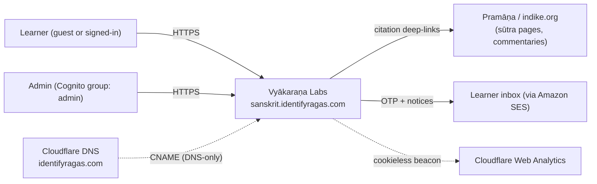
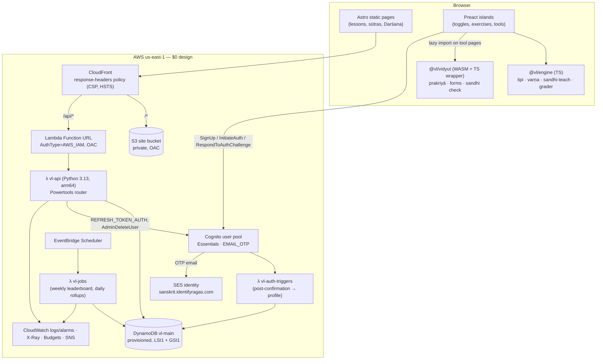
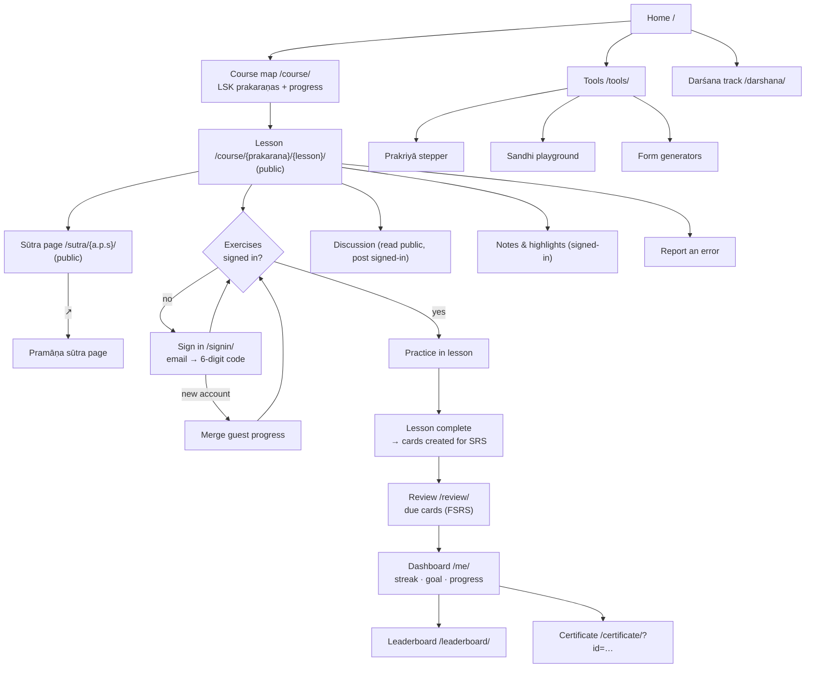
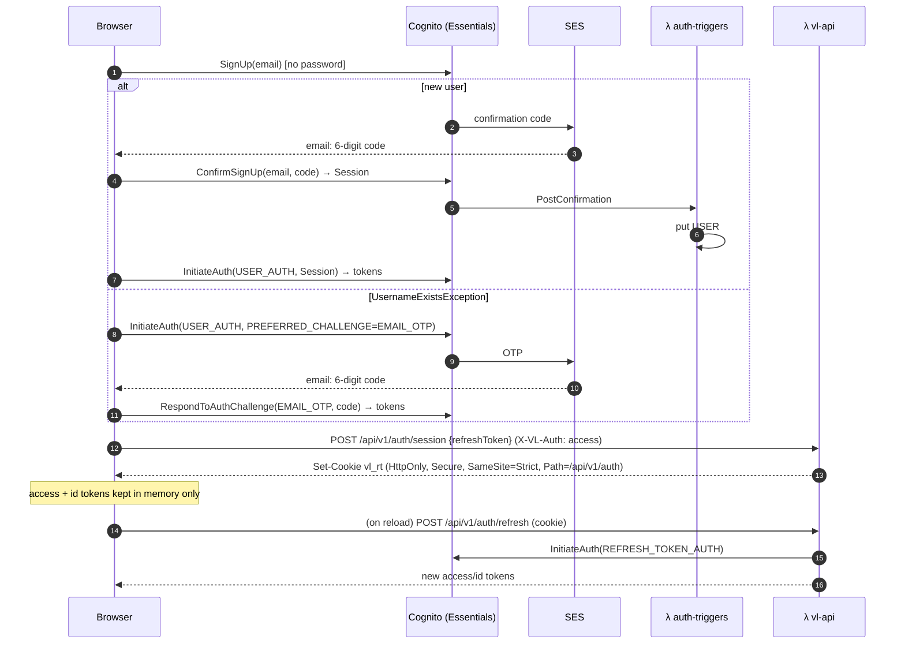
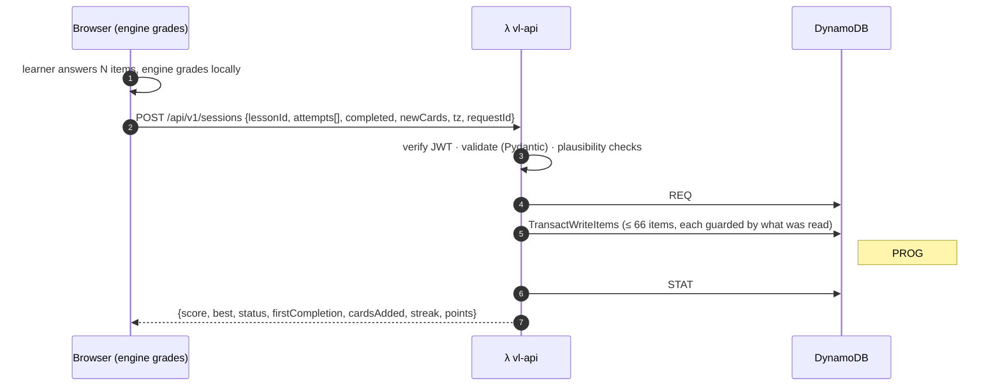

# Vyākaraṇa Labs — Architecture

> Interactive Sanskrit grammar course in **Laghusiddhāntakaumudī** order, grounded in **Pāṇini** (Aṣṭādhyāyī), **Patañjali** (Mahābhāṣya) and **Bhartṛhari** (Vākyapadīya). Every rule cites its sūtra and deep-links to Pramāṇa.
> Status: **v1 design, 2026-10-29**. Decisions trace to `docs/PROGRESS.md §2`. Items marked **⚑ verify** must be confirmed during implementation.

---

## 0. Decision summary

| Area | Decision | Why |
|---|---|---|
| **Hosting** | AWS, single region **us-east-1**, **$0 free-tier design** | User budget = $0; ACM-for-CloudFront lives in us-east-1 |
| **Front end** | **Astro (static output)** + **Preact islands**; MDX content collections | Content-heavy, SEO, near-zero JS on reading pages |
| **Edge** | **CloudFront**: `/*` → S3 (OAC), `/api/*` → **Lambda Function URL (OAC)** | Same origin ⇒ no CORS; Function URL is free, API Gateway is not (ADR-0002) |
| **API** | **Python 3.13 on Lambda (arm64)**, AWS Lambda Powertools, Pydantic v2, PyJWT, **py-fsrs** | User choice; server schedules reviews authoritatively |
| **Auth** | **Cognito Essentials**, **passwordless email one-time code** only; refresh token in **HttpOnly cookie** (token-handler) | Essentials = 10k MAU free, OTP needs Essentials; cookie keeps long-lived token away from JS |
| **Data** | **DynamoDB single table**, **provisioned** (≤ 25 RCU/WCU total), **LSI** for due-cards, sparse **GSI** for leaderboard | Always-free only applies to provisioned; LSI shares table capacity |
| **Grammar engine** | **Hybrid**: own **TypeScript** teaching engine + **vidyut-prakriya (MIT) → WASM** behind a TS API | Accurate sūtra-by-sūtra derivations (~2,000 rules) without re-implementing Pāṇini |
| **Email** | **SES** (subdomain identity, DKIM via Cloudflare) as Cognito's sender | Required for email OTP |
| **Analytics** | Learning data in DynamoDB + **Cloudflare Web Analytics** (cookieless, free) | No consent banner; no DynamoDB write cost per page view |
| **IaC / CI** | **Terraform** (S3 state + native lockfile) · **GitHub Actions + OIDC** | No long-lived AWS keys |
| **Domain** | `sanskrit.identifyragas.com` (Terraform var) via Cloudflare DNS, **DNS-only** CNAME | User's Cloudflare zone |
| **Look** | **Manuscript**: paper, ink, vermilion, saffron; serif Devanagari; palm-leaf sūtra folios | Round 4 |

---

## 1. System context



---

## 2. Containers (system setup)



### 2.1 Edge routing (CloudFront behaviours)

| Path | Origin | Cache policy | Notes |
|---|---|---|---|
| `/_astro/*`, `/fonts/*`, `/wasm/*` | S3 | `CachingOptimized`, 1 yr, immutable | Content-hashed filenames |
| `/*.html`, `/` | S3 | short TTL (60 s), invalidate on deploy | CloudFront Function rewrites `/x/` → `/x/index.html` |
| `/api/v1/leaderboard/*`, `/api/v1/certificates/*` | Function URL | 60 s, query-string keyed | Public, cacheable reads |
| `/api/*` (everything else) | Function URL | `CachingDisabled`; origin-request policy forwards `X-VL-Auth`, `x-amz-content-sha256`, cookies `vl_rt` | OAC overwrites `Authorization`, so JWT travels in `X-VL-Auth` |

- **POST/PUT bodies**: the browser sends `x-amz-content-sha256 = hex(SHA-256(body))` (`crypto.subtle.digest`). Required by Lambda OAC; handled once in the API client wrapper.
- **Security headers** (response-headers policy): `Content-Security-Policy` (`default-src 'self'; script-src 'self' 'wasm-unsafe-eval' https://static.cloudflareinsights.com; connect-src 'self' https://cognito-idp.us-east-1.amazonaws.com https://cloudflareinsights.com; img-src 'self' data:; style-src 'self'; font-src 'self'; frame-ancestors 'none'; base-uri 'self'; object-src 'none'`), `Strict-Transport-Security`, `X-Content-Type-Options`, `Referrer-Policy: strict-origin-when-cross-origin`, `Permissions-Policy`.

---

## 3. Flow map (learner journeys)



**Gating rules**
- **Public**: home, course map, lessons, sūtra pages, Darśana track, tools, leaderboard, certificate verification, discussion (read).
- **Account required**: exercises and their scoring, reviews, notes and highlights, posting comments, claiming certificates, settings, data export and deletion.
- **Guests**: "mark as read" and the last lesson visited are kept in `localStorage` (wrapped in try/catch), then merged into the account at first sign-in (§4.3).

---

## 4. Service flows

### 4.1 Sign-up / sign-in (passwordless email one-time code)



- **Token lifetimes**: access/id 60 min; refresh **30 days** (fewer OTP emails ⇒ lower SES cost).
- **Raw `fetch`** to `cognito-idp` with `X-Amz-Target` headers (no SDK; ~2 KB).
- **⚑ verify** at P7: password-less `SignUp` and session-based auto sign-in after `ConfirmSignUp`; whether `PASSWORD` must stay in `AllowedFirstAuthFactors` (the UI never offers it).
- **Trade-off**: `SignUp`-first reveals whether an email is registered. Acceptable for a learning site; documented in ADR-0004.

### 4.2 Practice session → progress, reviews, streak, leaderboard



- **Batched writes**: one request per session, not per answer. Transactions cost 2 WCU per item: a typical session is ~7 items (≈ 14 WCU, more on a first completion with new cards), absorbed by the 10 WCU table and its burst capacity at expected load.
- **Exactly once** (external review #1, fixed 2026-10-31): the client generates `requestId` (UUID) per save and keeps the save, unchanged, in a per-tab outbox (`apps/web/src/lib/outbox.ts`, sessionStorage) until the API confirms it; retries (button, reload, next page) resend the same id. The API writes `REQ#{requestId}` in the same transaction as the changes, so a replay returns the first response and counts nothing again; the same id with a different body → **409** `request-id-reused`. Every written value derived from a read is conditional on that read; a cancelled transaction is recomputed (4 tries, then **503** `busy`, safe to retry). Outbox entries are dropped on success, on a permanent 4xx, after 24 h (< the 7-day REQ TTL) and on sign-out.
- **Plausibility checks** (scoring is client-side): duration ≥ minimum per item, item IDs belong to the lesson, score ≤ items, monotonic timestamps.

### 4.3 Guest → account merge
- `POST /api/v1/progress/merge {read:[lessonId…], lastLesson}` → conditional `PutItem` per lesson (`attribute_not_exists`) so server data always wins.
- **Signed in, "Mark as read"** (review #7, fixed 2026-10-31): `POST /api/v1/progress/read {lessonId, read}` → mark = conditional `PutItem` (`attribute_not_exists`), unmark = conditional `DeleteItem` (`status = read`), so practice and completion are never overwritten; sent through the client outbox. The lesson page reads `GET /api/v1/progress/lessons` (one `begins_with(PROG#)` query, statuses only) and shows the account's lessons plus marks still waiting to be sent; practised/completed lessons count as read and cannot be unmarked.

### 4.4 Reviews (spaced repetition, FSRS)
- `GET /api/v1/reviews/due?limit=50` → **Query on LSI1** (`PK=USER#sub`, `LSI1SK ≤ DUE#now`).
- `POST /api/v1/reviews {items:[{cardId, rating 1–4, ms}] (≤ 50, each card once), tz, requestId}` → **py-fsrs** computes the next state and due date → one transaction: an `Update` per card conditional on its previous `due`, plus DAY/STREAK/LB and `REQ#` (as for sessions). Cards that are not the learner's or not due (> now + 1 min) are skipped and counted in `skipped` (review #8). The client keeps ratings in a sessionStorage draft as they are made, so a reload never loses them.
- Card **content is static** (built into the site as `cards/*.json`); the server stores only scheduling state.

### 4.5 Leaderboard (weekly, no XP)
- **Score** = correct reviews + 10 × lessons completed in the ISO week.
- **Opted-in by default** with an auto-generated pseudonym (e.g. *śiṣya-4821*); opt-out or rename in settings. Opted-out users get no GSI1 attributes (sparse index ⇒ not listed).
- `GET /api/v1/leaderboard/{yyyy-Www}` → Query GSI1 `PK=LB#week`, `ScanIndexForward=false`, `Limit 50`, cached 60 s at CloudFront.
- `vl-jobs` (Mondays 00:05 UTC) freezes last week's top 50 into a `LBSNAP#week` item.

### 4.6 Certificates
- `POST /api/v1/certificates {track}` → server checks every `PROG#` item in the track plus a final assessment ≥ 80 % → writes `CERT#id` (id = `VL-XXXX-XXXX`, base32) and a pointer item.
- `/certificate/?id=…` (static page) → `GET /api/v1/certificates/{id}` → name, track, date, verification badge; print stylesheet produces a PDF.

### 4.7 Discussion, notes, error reports
- **Comments**: `GET /api/v1/lessons/{id}/comments?cursor=` (public), `POST` (signed-in, ≤ 20/day/user via conditional counter), stored and rendered as **plain text**.
- **Notes & highlights**: anchored by `{lessonId, sutraId?, textQuote{exact,prefix,suffix}}`; rendered with the **CSS Custom Highlight API** (feature-detected; fallback `<mark>`).
- **Reports**: button on every sūtra, form table and lesson → `POST /api/v1/reports {target, message}` → `REPORT#open` queue → admin resolves.

### 4.8 Account lifecycle (privacy)
- `GET /api/v1/me/export` → JSON of all `USER#sub` items.
- `DELETE /api/v1/me` → batch-delete `USER#sub` items, anonymise comments, `AdminDeleteUser`.

---

## 5. Data model — DynamoDB `vl-main`

**Keys**: `PK`, `SK` (strings) · **LSI1** `LSI1SK` (shares table capacity) · **GSI1** `GSI1PK`/`GSI1SK` (sparse) · **TTL** `ttl`.
**Capacity ($0)**: table **10 RCU / 10 WCU**, GSI1 **5 / 5** → total ≤ 25/25 with headroom; auto-scaling **off**.

| Entity | PK | SK | Extra keys | Main attributes |
|---|---|---|---|---|
| Profile | `USER#{sub}` | `PROFILE` | — | pseudonym, settings{script, theme, dailyGoal, lbOptIn}, role, createdAt |
| Lesson progress | `USER#{sub}` | `PROG#{lessonId}` | — | status, bestScore, attempts, completedAt |
| SRS card | `USER#{sub}` | `CARD#{cardId}` | `LSI1SK=DUE#{iso}` | FSRS {stability, difficulty, state, reps, lapses, last, due} |
| Day activity | `USER#{sub}` | `DAY#{yyyy-mm-dd}` | `ttl` 400 d | reviews, lessons, ms |
| Streak | `USER#{sub}` | `STREAK` | — | current, longest, lastDate, version |
| Request record | `USER#{sub}` | `REQ#{requestId}` | `ttl` 7 d | kind, fingerprint (SHA-256 of the body), response (JSON), at |
| Note | `USER#{sub}` | `NOTE#{lessonId}#{ulid}` | — | anchor, text, color |
| Cert pointer | `USER#{sub}` | `CERT#{track}` | — | certId |
| Leaderboard row | `LB#{yyyy-Www}` | `U#{sub}` | `GSI1PK=LB#{week}`, `GSI1SK={score:08d}#{sub}` (opted-in only) | pseudonym, score |
| Leaderboard snapshot | `LBSNAP#{week}` | `TOP` | — | top50[] |
| Comment | `LESSON#{lessonId}` | `C#{iso}#{ulid}` | — | sub, pseudonym, body, status |
| Report | `REPORT#{open\|closed}` | `{iso}#{ulid}` | — | target, message, sub, resolution |
| Certificate | `CERT#{id}` | `META` | — | sub, name, track, issuedAt |
| Daily stats | `STAT#{yyyy-mm-dd}` | `GLOBAL` | — | sessions, reviews, signups, activeUsers (HLL-lite) |
| User directory | `USERDIR#{yyyy-mm}` | `{createdAt}#{sub}` | — | for admin listing without Scan |

**Access patterns → operations**

| # | Pattern | Operation |
|---|---|---|
| AP1 | Load my dashboard | `Query PK=USER#sub` (filter by SK prefix in app) |
| AP2 | Due cards | `Query LSI1 PK=USER#sub, LSI1SK ≤ DUE#now` |
| AP3 | Weekly top 50 | `Query GSI1 PK=LB#week desc, Limit 50` |
| AP4 | Lesson comments | `Query PK=LESSON#id, SK begins_with C#`, paginated |
| AP5 | Open reports | `Query PK=REPORT#open` |
| AP6 | Verify certificate | `GetItem CERT#id/META` |
| AP7 | Admin stats range | `BatchGetItem STAT#d/GLOBAL` |

---

## 6. API contract (`/api/v1`, JSON; full OpenAPI in `services/api/openapi.yaml`)

| Method | Path | Auth | Purpose |
|---|---|---|---|
| GET | `/health` | — | Liveness |
| POST | `/auth/session` | access | Store refresh token as HttpOnly cookie |
| POST | `/auth/refresh` | cookie | New access/id tokens |
| POST | `/auth/logout` | cookie | Revoke token + clear cookie |
| GET / PATCH / DELETE | `/me` | access | Profile + settings / delete account |
| GET | `/me/export` | access | Data export |
| GET | `/progress` | access | All lesson progress + streak |
| POST | `/progress/merge` | access | Guest merge |
| GET | `/progress/lessons` | access | Status of each touched lesson (read marks across devices) |
| POST | `/progress/read` | access | Mark / unmark a lesson as read |
| POST | `/sessions` | access | Batched practice results |
| GET | `/reviews/due` | access | Due cards |
| POST | `/reviews` | access | Review ratings → FSRS |
| GET | `/leaderboard/{week}` | — | Top 50 (cached) |
| GET | `/lessons/{id}/comments` | — | List comments |
| POST / DELETE | `/lessons/{id}/comments[/{cid}]` | access | Post / delete own |
| GET / POST / PATCH / DELETE | `/notes[/{id}]` | access | Notes & highlights |
| POST | `/reports` | access | Report an error |
| POST | `/certificates` | access | Claim certificate |
| GET | `/certificates/{id}` | — | Verify (cached) |
| GET | `/admin/stats` | admin | Daily aggregates |
| GET / PATCH | `/admin/reports[/{id}]` | admin | Triage queue |
| PATCH | `/admin/comments/{id}` | admin | Hide / restore |
| GET | `/admin/users` | admin | Paged directory |

**Conventions**: errors use RFC 9457 `application/problem+json`; cursor pagination (`next` = opaque base64 of `LastEvaluatedKey`); `requestId` body field on `POST /sessions` and `/reviews` (own `REQ#` record written inside the same transaction, TTL 7 d — chosen over Powertools idempotency, whose record is written separately from the changes).

---

## 7. Grammar engine

### 7.1 Packages

| Package | Language | Responsibility |
|---|---|---|
| `@vl/engine/lipi` | TS | IAST ↔ Devanagari ↔ **SLP1** (internal) ↔ Harvard-Kyoto / ITRANS input; live transliterating input field |
| `@vl/engine/varna` | TS | 14 Śivasūtras, **it-saṃjñā** (1.3.2–1.3.9), **pratyāhāra** expansion (*ādir antyena sahetā* 1.1.71), **savarṇa** (1.1.9), guṇa/vṛddhi (1.1.1–1.1.3), sthāna/prayatna tables |
| `@vl/engine/teach` | TS | Step-animation models for lessons (small, hand-written rule pipelines with sūtra IDs) |
| `@vl/engine/grade` | TS | Exercise checking (normalise script, accept variants, partial credit) |
| `@vl/vidyut` | Rust → WASM + TS | Wraps **vidyut-prakriya**: `deriveSubanta`, `deriveTinanta`, `deriveKrdanta`, `deriveTaddhita`; returns `{form, steps:[{sutra, result}]}`; maps SLP1 → display script; joins sūtra codes to `data/sutras` |

### 7.2 Integration of vidyut-prakriya
- **Build**: `wasm-pack build --target web` from a **pinned vidyut release tag** in CI (`wasm.yml`); output goes to `apps/web/public/wasm/` with a hashed filename.
- **Load**: lazily, only on tool pages and exercise widgets that need it, via `import()` plus `WebAssembly.instantiateStreaming`; Dhātupāṭha data is fetched once and cached (HTTP immutable).
- **Rule codes**: Aṣṭādhyāyī codes (`a.p.s`) link to Pramāṇa; vārttika and other non-sūtra codes get a tooltip without a link.
- **⚑ verify**: WASM bundle size (budget ≤ 2.5 MB compressed incl. data), licence of `vidyut-data`'s Dhātupāṭha before bundling, and current WASM API names.

---

## 8. Website system — information architecture & layout

### 8.1 Routes

| Route | Type | Content |
|---|---|---|
| `/` | static | Hero (*atha śabdānuśāsanam*), course path preview, tools, Darśana teaser |
| `/start/` | static | **Varṇamālā primer** (script + sounds) for non-Devanagari readers |
| `/course/` | static + island | LSK map: prakaraṇa tree, progress ticks (island) |
| `/course/{prakarana}/{lesson}/` | static + islands | Lesson (anatomy §8.3) |
| `/sutra/{a.p.s}/` | static | One page per cited sūtra: text, padaccheda, anuvṛtti, vṛtti, translation, where used, Pramāṇa link |
| `/sutras/` | static | Index of all cited sūtras by adhyāya/pāda and by LSK number |
| `/tools/prakriya/`, `/tools/sandhi/`, `/tools/forms/` | static shell + WASM | Interactive tools |
| `/darshana/` and `/darshana/{topic}/` | static | Patañjali & Bhartṛhari track |
| `/glossary/` | static | Saṃjñā terms (it, pratyāhāra, guṇa, vṛddhi, ghi, nadī…) |
| `/review/` | island (auth) | SRS session |
| `/me/` | island (auth) | Dashboard: streak, daily goal, heatmap, progress, certificates |
| `/me/notes/` | island (auth) | All notes and highlights |
| `/settings/` | island (auth) | Script default, theme, daily goal, leaderboard opt-out / pseudonym, export, delete |
| `/leaderboard/` | island | Weekly table (semantic `<table>`) |
| `/certificate/` | island | Verification by `?id=` |
| `/signin/` | island | Email → code |
| `/admin/` | island (admin) | Stats, reports, moderation, users |
| `/sources/` | static | Bibliography, editions, licences, Pramāṇa credit |
| `/about/`, `/privacy/` | static | |

### 8.2 App shell (desktop ≥ 64 rem)

```
┌──────────────────────────────────────────────────────────────────────────────┐
│ ◈ Vyākaraṇa Labs   Course   Tools   Darśana   Review (12)    [अ/a]  ◐  [Me] │  ← sticky header
├───────────────┬──────────────────────────────────────────┬───────────────────┤
│ LSK PRAKARAṆA │  Saṃjñā › Lesson 3 · Pratyāhāra          │  MARGIN (folio)   │
│ ▾ Saṃjñā   ✓  │  ─────────────────────────────────────── │  ┌ Bhāṣya ──────┐ │
│   1 Śivasūtra✓│  ┃ आदिरन्त्येन सहेता ॥ १।१।७१ ॥  [↗]     │  │ Patañjali on │ │
│   2 It      ✓ │  ┃ ādir antyena sahetā                  │  │ why markers… │ │
│ ▸ 3 Pratyāhāra│  ┃ An initial item, together with a     │  └──────────────┘ │
│ ▸ Ac-sandhi   │  ┃ final it-marker, denotes itself and  │  ┌ Darśana ─────┐ │
│ ▸ Hal-sandhi  │  ┃ everything in between.               │  │ Bhartṛhari … │ │
│ ▸ Visarga     │                                          │  └──────────────┘ │
│ ▸ Ajanta puṃ  │  [ Try it: expand "ac" ▸ ]  (island)     │  Your notes (2)   │
│   …           │                                          │  Cited: 1.1.71,   │
│               │  ≤ 70ch reading column                   │  1.3.3            │
├───────────────┴──────────────────────────────────────────┴───────────────────┤
│ ◂ Previous lesson                   Mark complete           Next lesson ▸   │  ← stable position
└──────────────────────────────────────────────────────────────────────────────┘
```

- **Left rail**: `<nav aria-label="Course">` with nested `<details>`; collapses below 64 rem into a `<dialog>` drawer.
- **Right margin**: Bhāṣya / Darśana panels, notes, cited-sūtra list; below 80 rem it moves inline after each sūtra card as `<details>` blocks.
- **Mobile (< 40 rem)**: single column; bottom tab bar (Course · Tools · Review · Me) built from real `<a>` elements; panels become `popover`s.
- **Script toggle** `[अ/a]`: a `<button aria-pressed>` in the header that flips `data-script="deva|iast|both"` on `<html>`; persisted in localStorage (guests) and the profile (signed-in).
- **Theme**: system by default; two-state override (system ↔ opposite) works without JS via `color-scheme`; no flash thanks to the meta tag and inline root attribute.

### 8.3 Lesson anatomy

| Block | Element | Content |
|---|---|---|
| Header | `<header>` | Prakaraṇa breadcrumb, LSK sūtra range, estimated time, progress |
| **Sūtra folio** | `<article class="folio">` | Devanagari (+ IAST), LSK number, **Aṣṭādhyāyī a.p.s → Pramāṇa chip**, padaccheda, anuvṛtti (carried words highlighted), vṛtti (gloss), plain-English meaning, "why it matters" |
| Worked example | island | Step-through using `@vl/engine/teach` or the vidyut stepper |
| **Bhāṣya** panel | `<aside>` | Patañjali (Mahābhāṣya) quote + translation + commentary, cited by sūtra / vārttika |
| **Darśana** panel | `<aside>` | Bhartṛhari (Vākyapadīya) verse + translation, cited kāṇḍa.verse with edition |
| Practice | island (gated) | 5–12 items; types below |
| Discussion | `<section>` | Thread + composer (signed-in) |
| Footer actions | `<nav>` | Previous · Mark complete · Next, fixed order and position |

**Exercise types**: multiple choice · type the form (transliterating input) · sandhi join/split · name the sūtra · order the derivation steps (keyboard-operable list) · fill the paradigm table.

### 8.4 Tool layouts
- **Prakriyā stepper**: input row (root/stem · lakāra/vibhakti · puruṣa/vacana) → result form → ordered list of steps; each step = sūtra chip + before/after with the changed segment highlighted; keyboard ←/→ to step; "explain this sūtra" opens a `popover`.
- **Sandhi playground**: two transliterating inputs → joined output → rule trace with sūtra chips; "split" mode for reverse lookup on a known set.
- **Form generators**: semantic `<table>` (7 vibhaktis + sambodhana × 3 vacanas; 3 puruṣas × 3 vacanas per lakāra); each cell links to its derivation.

### 8.5 Design system (Manuscript)
- **Tokens** (`apps/web/src/styles/tokens.css`, `@layer tokens`): `--p-*` (oklch primitives from paper `#F6EFE2`, ink `#1E1A16`, vermilion `#B3361F`, saffron `#D98E1F`, plus palm-leaf and lamp-black ramps) → `--s-*` (`--s-color-surface`, `--s-color-text`, `--s-color-accent`, `--s-color-citation`, spacing and type scale; `light-dark()` only here) → `--c-*` (component overrides with semantic fallbacks).
- **Layers**: `@layer tokens, atoms, molecules, organisms, pages;`
- **Type**: serif Devanagari tuned for Sanskrit conjuncts (candidate: Tiro Devanagari Sanskrit, OFL) · Latin serif with full IAST diacritics for reading · restrained UI face; self-hosted, subset with `unicode-range`; `font-size-adjust: from-font` across mixed scripts; `text-wrap: balance` (headings), `pretty` (paragraphs); fluid `clamp()` scale; `rem` only.
- **Texture**: paper grain via CSS mask / gradient (no images on text); palm-leaf folio = rounded long card with binding-hole motif and ruled lines.
- **Accessibility**: WCAG 2.2 AA contrast (4.5:1 text, 3:1 UI); state never shown by colour alone; `forced-colors` mappings; visible focus rings; `prefers-reduced-motion` drops decorative motion only; targets ≥ 24 px; `lang="sa"` on Sanskrit spans (`sa-Latn` for IAST).
- **Agent-ready**: semantic HTML, linked labels, stable action positions, no ghost overlays; **WebMCP** tools registered when `navigator.modelContext` exists (`lookup_sutra`, `sandhi_join`, `decline`, `conjugate`) **⚑ verify API shape**.

---

## 9. Content plan

### 9.1 Course (Laghusiddhāntakaumudī order)
**Primer** (non-LSK): Varṇamālā, pronunciation (sthāna/prayatna), reading Devanagari conjuncts.

| Module | LSK prakaraṇa(s) | v1 depth |
|---|---|---|
| M1 | **Saṃjñā** (Māheśvara sūtras, it, pratyāhāra, savarṇa, guṇa/vṛddhi, saṃyoga, pada…) incl. the paribhāṣās LSK uses | Full |
| M2 | **Ac-sandhi** (incl. prakṛtibhāva) | Full |
| M3 | **Hal-sandhi** | Full |
| M4 | **Visarga-sandhi** | Full |
| M5 | **Ajanta** puṃliṅga · strīliṅga · napuṃsakaliṅga | Full (rāma, hari, guru, pitṛ, ramā, mati, nadī, dhenu, jñāna, vāri, madhu …) |
| M6 | **Halanta** puṃliṅga · strīliṅga · napuṃsakaliṅga | Core stems |
| M7 | **Avyaya** | Full |
| M8 | **Tiṅanta**: bhvādi → curādi; ṇijanta, sannanta, yaṅanta, nāmadhātu; ātmane/parasmaipada; bhāva-karma; lakārārtha | Bhvādi full (10 lakāras); one model root per other gaṇa; secondary conjugations intro |
| M9 | **Kṛdanta**: kṛtya, pūrvakṛdanta, uṇādi, uttarakṛdanta | Core kṛt (ktvā, lyap, tumun, kta, ktavatu, śatṛ, śānac, tavyat/anīyar/yat) |
| M10 | **Vibhaktyartha** (Kāraka) | Full |
| M11 | **Samāsa**: kevala, avyayībhāva, tatpuruṣa, bahuvrīhi, dvandva, samāsānta | Core |
| M12 | **Taddhita** | Selected (apatya, matup, bhāva) |
| M13 | **Strīpratyaya** | Core (ṭāp, ṅīp, ṅīṣ, ūṅ) |

**⚑ verify** prakaraṇa boundaries and sūtra numbering against a standard LSK edition while keying content (the Siddhāntakaumudī has a separate Paribhāṣā-prakaraṇa).

### 9.2 Darśana track
| Topic | Primary source |
|---|---|
| D1 Why study grammar: *rakṣohāgamalaghvasandehāḥ prayojanam* | Mahābhāṣya, Paspaśāhnika |
| D2 What is a word: *yenoccāritena sāsnā-lāṅgūla-…* | Paspaśāhnika |
| D3 *Siddhe śabdārthasambandhe*: word, meaning and relation as established | Kātyāyana vārttika 1 + Bhāṣya |
| D4 Rules instead of word lists (Bṛhaspati teaching Indra) | Paspaśāhnika |
| D5 Universal vs individual (*ākṛti* / *dravya*: Vājapyāyana vs Vyāḍi) | Mahābhāṣya on 1.2.64 |
| D6 *Śabdatattva*: *anādinidhanaṃ brahma…* | Vākyapadīya 1.1 |
| D7 Sphoṭa and dhvani | Vākyapadīya, Brahmakāṇḍa |
| D8 Language and cognition: *na so 'sti pratyayo loke…* | Vākyapadīya, Brahmakāṇḍa |
| D9 The sentence as the unit; *pratibhā* | Vākyapadīya, Vākyakāṇḍa |
| D10 Kāraka as semantic power (*śakti*) | Vākyapadīya 3, Sādhanasamuddeśa |

**⚑ verify** Vākyapadīya verse numbers per edition (Rau vs Iyer); cite the edition on `/sources/`.

### 9.3 Data files
- `data/sutras/*.yaml`: `{id: "1.1.71", lsk: n, deva, iast, padaccheda[], anuvrtti[], vrtti, meaning, notes, pramana: url}`; text keyed from public-domain originals; **no bulk import** of GRETIL (CC BY-NC-SA).
- `apps/web/src/content/lessons/*.mdx`: frontmatter `{prakarana, order, sutras[], cards[], estMinutes}`; schema validated with zod.
- `apps/web/src/content/darshana/*.mdx`: `{source, ref, edition}`.
- Build-time check: every `a.p.s` in content resolves to a `data/sutras` entry.
- **Citation chips**: Pramāṇa sūtra URL when the sūtra exists there, otherwise the **pāda URL** (Pramāṇa's 1.1 stops at 1.1.45); availability comes from `data/pramana.json` (to be refreshed by a CI job using Pramāṇa's API).

---

## 10. Infrastructure as code

```
infra/terraform/
├─ bootstrap/            # once, local state: state bucket (versioned, SSE-S3), GitHub OIDC provider + roles
├─ modules/
│  ├─ site/              # S3, OAC, CloudFront, CF Function (index rewrite), response-headers policy, ACM (us-east-1)
│  ├─ api/               # Lambda (vl-api, vl-jobs, vl-auth-triggers), Function URL + OAC permission, log groups (7 d)
│  ├─ data/              # DynamoDB vl-main (provisioned, LSI1, GSI1, TTL)
│  ├─ auth/              # Cognito pool (Essentials, EMAIL_OTP, USER_AUTH), app client (public), admin group, triggers
│  ├─ email/             # SES domain identity + DKIM outputs (records to add in Cloudflare)
│  ├─ jobs/              # EventBridge Scheduler schedules
│  └─ observability/     # alarms (≤ 10), SNS email topic, AWS Budgets (2 free), X-Ray sampling
└─ envs/prod/            # backend "s3" { use_lockfile = true }, variables (domain, alert_email)
```

- **State**: S3 backend with **native lockfile** (Terraform ≥ 1.10), no DynamoDB lock table.
- **Encryption**: AWS-managed keys only (customer-managed KMS keys cost $1/month).
- **Lambda packaging**: `uv export` → `pip install --platform manylinux2014_aarch64 --only-binary=:all:` → zip; built in CI.
- **DNS**: Terraform outputs the CNAMEs (ACM validation, SES DKIM ×3, site) for the user to add in Cloudflare (or managed via the Cloudflare provider later).

## 11. CI/CD

> **Superseded in detail by `docs/QUALITY.md` §2–§3 (2026-10-30).** The vidyut WASM is now built in CI by `scripts/build-vidyut.sh` (no `wasm.yml`, nothing committed).

| Workflow | Trigger | Steps |
|---|---|---|
| `ci.yml` | PR | pnpm install → lint/typecheck → Vitest (engine) → Astro build + content checks → Playwright smoke + **axe** → ruff + mypy + pytest (moto) → terraform fmt/validate/tflint → `terraform plan` (read-only OIDC role) posted to the PR |
| `deploy.yml` | green `ci` run on `main` (`workflow_run`) | build web → build Lambda zip → `terraform apply` (deploy OIDC role, environment `prod`; IAM only on `vl-app-*` roles with the `vl-app-boundary` permissions boundary) → `aws s3 sync` (hashed assets immutable; HTML short TTL) → CloudFront invalidation `/*` |
| `wasm.yml` | manual / vidyut tag bump | `wasm-pack` build → size check → commit artifact to `apps/web/public/wasm/` |

## 12. Observability & $0 guardrails

| Guardrail | Setting |
|---|---|
| Log retention | 7 days for all log groups |
| Custom metrics | ≤ 10 (EMF) |
| Alarms (≤ 10 free) | API 5xx, Lambda errors/throttles, DynamoDB throttled requests, CloudFront 5xx rate, Cognito sign-in failure spike |
| Budgets (2 free) | Actual > $0.01 and forecast > $1 → email |
| Throughput caps | DynamoDB provisioned (hard ceiling); Lambda timeout 10 s, memory 256 MB arm64; per-user comment/report caps |
| Not used (cost) | API Gateway, WAF, Route 53, Secrets Manager, customer-managed KMS keys, NAT, PITR (enable later) |

**Expected monthly bill**: **$0.00**, apart from SES at about **$0.10 per 1,000 OTP emails** (covered by new-account credits where applicable) and fractions of a cent for S3 storage. **⚑ verify** whether CloudFront's flat-rate Free plan (which bundles WAF) is available and worth switching to.

## 13. Quality targets

> **Expanded in `docs/QUALITY.md` §4–§5 (2026-10-30).**

| Area | Target |
|---|---|
| Performance | LCP ≤ 1.8 s (4G, mid-range phone) · INP ≤ 200 ms · CLS ≤ 0.05 · reading-page JS ≤ 50 KB gz · fonts ≤ 150 KB |
| Accessibility | WCAG 2.2 AA; axe clean on CI; keyboard-only paths for every exercise and tool |
| Engine | Vitest: Śivasūtra/pratyāhāra golden tests; paradigm tables vs. known forms; vidyut wrapper snapshot tests |
| API | pytest ≥ 85 % on handlers; moto DynamoDB; contract tests from OpenAPI |
| Baseline | **Baseline 2024**; newer features (`text-box`, Custom Highlight, `contrast-color()`) behind `@supports` / feature detection |

## 14. What Kartik sets up (user-side checklist)

| # | Task | When | Detail |
|---|---|---|---|
| U2 | **AWS account** | before M2 | Root MFA; IAM Identity Center admin user; region us-east-1; enable **Cost Explorer**; leave free-tier alerts on |
| U3 | **Bootstrap Terraform** | M2 | Run `infra/terraform/bootstrap` once from your PC (AWS CLI v2 + Terraform ≥ 1.10, PowerShell commands provided) → creates state bucket + GitHub OIDC roles |
| U4 | **GitHub settings** | M2 | Repo **Variables**: `AWS_ROLE_ARN`, `AWS_REGION`; create environment `prod` (optional required reviewer = you) |
| U5 | **Cloudflare DNS** | M2 / M3 | Add CNAMEs from Terraform output: ACM validation, `sanskrit` → `dxxxx.cloudfront.net` (**DNS-only, grey cloud**), 3× SES DKIM |
| U6 | **SES production access** | M3 | Console → SES → Account dashboard → *Request production access* (use case: transactional sign-in codes) |
| U7 | **Admin role** | M5 | After first sign-in: add yourself to Cognito group `admin` (CLI command provided) |
| U8 | **Cloudflare Web Analytics** | M6 | Add site in Cloudflare dashboard → copy beacon token into repo variable `CF_BEACON_TOKEN` |
| U9 | **Alert email** | M2 | Confirm the SNS subscription email for alarms and budgets |

## 15. Delivery milestones

| Milestone | Scope | Live result |
|---|---|---|
| **M1** | Monorepo scaffold, design system, primer + M1–M2 lessons, sūtra pages, static deploy scripts | Local preview |
| **M2** | Terraform `site` module + CI/CD | **First public URL** (static course) |
| **M3** | Cognito + API (`/me`, `/progress`, `/sessions`) + sign-in UI + guest merge | Accounts + exercises |
| **M4** | Engine + vidyut WASM + all three tools; reviews (FSRS); streaks; leaderboard | Full practice loop |
| **M5** | Discussion, notes/highlights, error reports, admin dashboard | Community + moderation |
| **M6** | Certificates, Darśana track, content waves M3–M13, analytics | Feature-complete v1 |
| **M7** | Hardening: a11y audit, performance, load sanity, docs, ADRs, README | **Launch** |

## 16. Architecture decision records (to write in `docs/adr/`)
- **ADR-0001** Static-first Astro with islands
- **ADR-0002** CloudFront → Lambda Function URL (OAC) instead of API Gateway ($0)
- **ADR-0003** Single-table DynamoDB, provisioned, LSI for due cards
- **ADR-0004** Passwordless Cognito + token-handler cookie
- **ADR-0005** Hybrid grammar engine with vidyut-prakriya WASM
- **ADR-0006** Cloudflare Web Analytics for cookieless page metrics

## 17. Risks

| Risk | Impact | Mitigation |
|---|---|---|
| Client-side grading can be gamed | Leaderboard integrity | Plausibility checks; leaderboard weights reviews (server-scheduled); certificates need a final assessment |
| DynamoDB throttling at peaks | Failed saves | Batched sessions, client retry queue, alarms; raise capacity (small cost) if sustained |
| SES sandbox / deliverability | Users can't sign in | Request production access early (U6); DKIM aligned; plain-text OTP mails |
| vidyut WASM size or API drift | Slow tools | Lazy-load, pin version, size budget in CI |
| Content accuracy | Credibility | Cite every rule; "report an error" everywhere; golden tests vs. known paradigms |
| Licensing | Takedown | Original prose and translations; public-domain source texts; link out to GRETIL/Pramāṇa rather than copying |
